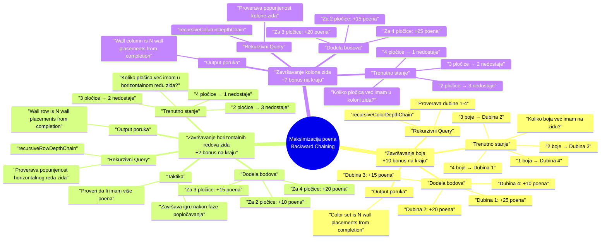
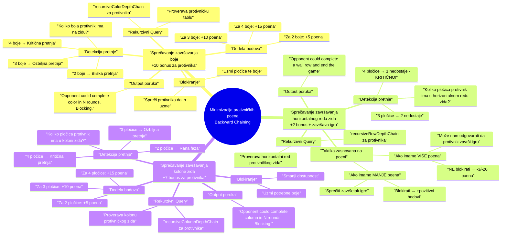

# AIZUL - Ekspertski sistem za igranje društvene igre Azul

Članovi tima:
- Boris Markov SV73/2021
- Gojko Vučković SV49/2021

# Opis problema

### Motivacija

Tokom poslednje decenije industrija društvenih igara je postala mnogo razvijenija i pristupačnija prosečnom čoveku. Razvijaju se nove i moderne društve igre različitih kompleksnosti koje vrlo brzo postaju "kultni klasici" na policama kolekcionara, porodica, pa i povremenih igrača. Jedna od ovih igara, koju bismo želeli da istaknemo je upravo ***Azul*** iz 2017. godine. Smatramo da ova igra ima veliku kompleksnost i različite zanimljive strategije igranja, ali sa vrlo jednostavnim pravilima igranja. Detaljnije o igri možete pročitati [ovde](https://en.wikipedia.org/wiki/Azul_(board_game)).

Obojica volimo ovu igru i često je igramo, sa time u vidu, želimo da odamo počast ***Azul***-u i približimo ljudima time što ćemo napraviti pametnog agenta, uz kojeg će ljudi moći da interaktivno nauče da je igraju, ili unapređuju svoje veštine.

- - -
### Pregled problema

Ukratko, pravila igre su sledeća:

- Igrači skupljaju pločice (keramičke pločice različitih boja i dezena) i postavljaju ih na svoju ličnu tablu sa ciljem da ukrase zid palate. U svakoj rundi postoje krugovi („fabrike“) iz kojih se biraju pločice. Kada je igrač na potezu, on izabere sve pločice iste boje iz jedne fabrike i prenese ih u jedan od svojih **redova za pripremu** na levoj strani table. Sve ostale pločice iz te fabrike premeštaju se u centralni krug i odatle ih kasnije igrači mogu uzimati.

- Kada se svi krugovi isprazne, završava se runda i po jedna pločica iz svakog popunjenog **reda za pripremu** premešta se na odgovarajuće mesto na **zidu**, na desnoj strani table. Svaka pločica postavljena na zid donosi poene u zavisnosti od horizontalnog i vertikalnog povezivanja. Pločice koje ne mogu da se smeste idu u **red poda** i oduzimaju poene.

- Igra se završava nakon faze popločavanja zida u kojoj neki igrač popuni jedan **horizontalni red zida**. Nakon toga sledi završno bodovanje – dodatni poeni se dobijaju za kompletne horizontalne redove zida, kolone zida ili svih pet pločica iste boje na zidu. Pobednik je igrač sa najviše osvojenih poena.

U nastavku se koriste sledeći termini:
- **Red za pripremu** (*pattern line*) predstavlja jedan od pet redova na levoj strani table, kapaciteta od 1 do 5 pločica.
- **Horizontalni red zida** (*wall row*) predstavlja red od pet polja na zidu, na desnoj strani table.
- **Kolona zida** (*wall column*) predstavlja vertikalnu kolonu od pet polja na zidu.
- **Red poda** (*floor line*) predstavlja kazneni red na dnu table.

## Lokalna instalacija i pokretanje (bez Docker-a)

Potrebni su Java 11, Maven i Node.js 18.18 ili noviji. Maven wrapper u repozitorijumu nije kompletan, pa se koriste sistemske `mvn` komande.

Iz korena repozitorijuma prvo izgradite backend module ovim redosledom:

```bash
cd aizul/model
mvn clean install

cd ../kjar
mvn clean install

cd ../service
mvn spring-boot:run
```

Backend zatim sluša na `http://localhost:8080`. U drugom terminalu pokrenite frontend:

```bash
cd aizul-front
npm install
npm run dev
```

Frontend je dostupan na `http://localhost:3000`, a CORS konfiguracija backend-a dozvoljava lokalne frontend portove 3000 i 3001. Ako je port 8080 zauzet, pre pokretanja proverite proces komandom `sudo lsof -i :8080`. API smatra da je trenutni igrač prvi element niza `players`; frontend zato šalje donju tablu kao `players[0]`.


*Slika 1 - Prikaz jednog stanja table igrača*

Nalik šahu, pravila igre su prilično jednostavna, međutim postoji bezbroj različitih strategija za igranje i odabir najboljeg poteza može biti vrlo kompleksan. Sa time, želimo da napravimo agenta sa osnovnom funkcionalnošću da odredi najbolji mogući potez u datom stanju table.

Većina implementacija ekspertskih sistema za igranje tabličnih igara poput ***Azul*** su zasnovana na algoritmima poput ***minimax***, ***Monte Carlo Tree Search*** ili ***mašinskog učenja***. Interaktivni sistemi koji su namenjeni da objasne i nauče igrače da igraju se često zadržavaju samo na jednoj rundi (ili par njih) koja je skoro uvek unapred predodređena i linearna bez prilike za učenje kompleksnih strategija. Sa time, naš projekat bi zasnovali na *pravilima*, *forward i backwards chaining*, i *complex event processing* (za šta smatramo da je ***Azul*** naročito pogodan), sa funkcionalnošću da **objasni odluku svog poteza koji smatra optimalnim**. Verujemo da će ovakav pristup omogućiti korisnicima da bolje nauče da igraju ***Azul*** od drugih već postojećih rešenja.

Primeri implementacija, inspiracije i relevantna literatura:
1. [AlphaGo - program koji igra tabličnu igru Go](https://deepmind.google/research/projects/alphago/)
2. [AzulAI - *"program koji igra Azul bolje od čoveka"*](https://domwil.co.uk/posts/azul-ai/#comparison)
3. [The Design of Azul - analiza i tekst o tome šta je dobar izbor u igrama](https://jboger.medium.com/the-design-of-azul-8ab36d21d3a5)

- - -
### Metodologija rada

Sistem je podeljen u tri koherentna sloja koji rade zajedno:

1. Forward Chaining Layer
- Lanac pravila kroz koji će svaki od mogućih poteza proći, u njemu uključujemo taktičko i strateško rezonovanje. On će sadržati pet pravila koja dodeljuju ili oduzimaju bodove po kojima određujemo koliko je potez dobar (primere tih pravila možete videti u sledećem poglavlju).

	- Ulaz: trenutno stanje igre (table, fabrike, centar, redovi poda, protivnici), kao i lista svih mogućih poteza.
	- Izlaz: najbolji potez sa objašnjenjem.

2. Template Layer
- Dinamično napravljena forward chain pravila u odnosu.

	- Ulaz: jedan potez i originalno stanje table trenutnog igrača; svaki potez se evaluira odvojeno da se činjenice različitih poteza ne bi ukrštale.
	- Izlaz: modifikacija score-a poteza, ne bira potez direktno.

3. Backward Chaining Layer
- Proverava da li predloženi potez zadovoljava dugoročne ciljeve u zavisnosti od faze igre, može menjati (više o tome u poglavlju za backward chaining).

	- Ulaz: trenutno stanje igre (table, fabrike, centar, redovi poda, protivnici), kao i lista svih mogućih poteza.
	- Izlaz: najbolji potez sa objašnjenjem.

#### Forward chaining

Forward chaining je proces u kojem se pravila primenjuju na osnovu trenutnog stanja igre kako bi se pronašao najbolji potez. Ovaj proces se obično izvršava u realnom vremenu i ne zahteva previše izračuna. U našem slučaju, forward chaining ima pet pravila koja evaluiraju dati potez i rangiraju ga uz pomoć bodova. Svaki potez dobija bodove na osnovu svih pravila, a onaj sa najviše bodova se bira kao najbolji potez.

Forward chain pravila koja smo implementirali su sledeća:
- **Pravilo 1:** Da li potez uzima boju koja je protivniku potrebna da završi započeti red za pripremu - **+8 bodova**
- **Pravilo 2:** Da li potezom nastavljamo red za pripremu koji smo već započeli - **+3 bodova**
- **Pravilo 3:** Da li će potez, nakon faze popločavanja, završiti horizontalni red zida i time završiti igru dok pobeđujemo/gubimo - **+15/-15 bodova**
- **Pravilo 4:** Da li uzimamo token prvog igrača - **+2 bodova**
- **Pravilo 5:** Da li potezom imamo pločice koje se prelivaju u pod - **-10 bodova**

#### Template Layer

Template layer predstavlja dinamičko kreiranje pravila u realnom vremenu na osnovu trenutnog stanja igre. Koristi Drools template (.drt) fajlove koji se kompajliraju u izvršna pravila tokom runtime-a.

Implementirali smo dva tipa template pravila:

##### Prioritet redova za pripremu
**Template fajl**: `row_priority.drt`
**Svrha**: Dodeljivanje progresivnih bodova na osnovu reda za pripremu u koji se pločice postavljaju

**Implementacija**: Za svaki red za pripremu (0-4) generiše se zasebno pravilo koje dodeljuje bodove:
- **Red za pripremu 1:** +1 bod
- **Red za pripremu 2:** +2 boda
- **Red za pripremu 3:** +3 boda
- **Red za pripremu 4:** +4 boda
- **Red za pripremu 5:** +5 bodova

##### Završavanje redova za pripremu
**Template fajl**: `row_completion.drt`
**Svrha**: Bonus bodovi kada potez dovršava red za pripremu na levoj strani table

**Implementacija**: Za svaki red za pripremu generiše se pravilo koje proverava da li ga potez dovršava i dodeljuje bonus bodove na osnovu njegove veličine:
- **Red za pripremu 1:** +7 bodova (5 + 1*2)
- **Red za pripremu 2:** +9 bodova (5 + 2*2)
- **Red za pripremu 3:** +11 bodova (5 + 3*2)
- **Red za pripremu 4:** +13 bodova (5 + 4*2)
- **Red za pripremu 5:** +15 bodova (5 + 5*2)


#### Backwards chaining

Dugoročni ciljevi variraju u zavisnosti od toga koliko rundi se već odigralo, koja je veština protivnika, subjektivnog mišljenja igrača koja je najbolja strategija za pobeđivanje u igri i samog toka igre. Sa time u vidu, implementirali smo dve kategorije backward chain ciljeva: za **Našu tablu** i **Protivničku tablu**

**Princip rada** - Za backward chaining smo koristili **rekurzivni upit** koji proverava da li će potez pomoći u određenom cilju za različite dubine (primer: za 1/2/3/4 već postavljene pločice iste boje) i dodeljuje bodove na osnovu trenutnog stanja naše ili protivničke table. Bonus za naš zid važi samo ako potez popunjava baš izabrani red za pripremu, tako da se u sledećoj fazi jedna pločica zaista prenosi na svoje tačno polje zida. Procena protivničke pretnje analogno zahteva da je u uzetoj grupi dovoljno pločica da protivnik popuni kompatibilan red za pripremu.

### Prvi backward chain

### Kategorija: **Naša tabla**
---
U ovoj kategoriji gledamo podciljeve koji su bazirani na gledanju naše table, a ti podciljevi su sledeći:

##### Podciljevi
1. Završavanje boja
2. Završavanje horizontalnih redova zida
3. Završavanje kolona zida
---
#### 1. Završavanje boja
**Opis**: Ako uspeš da popuniš svih 5 polja iste boje na tabli, dobijaš **+10 poena na kraju igre**. Ovo je dugoročna strategija.

**Implementacija**: Ako potez koji trenutno evaluiramo uzima pločice boje ka kojoj težimo da popunimo na našoj tabli, dodajemo bodove u odnosu na koliko već postavljenih boja imamo na tabli:
 - **Za 1 pločicu** dobijamo **+10 bodova**
 - **Za 2 pločice** dobijamo **+15 bodova**
 - **Za 3 pločice** dobijamo **+20 bodova**
 - **Za 4 pločice** dobijamo **+25 bodova**
---
#### 2. Završavanje horizontalnih redova zida
**Opis**: Ako tokom faze popločavanja popuniš ceo horizontalni red zida, dobijaš **+2 poena na kraju igre**, a igra se završava nakon te faze. Ovo je lakše dostižno nego završavanje boje ili kolone zida. Zato moramo da pazimo na trenutne i projektovane poene igrača, jer ne želimo da izazovemo kraj igre ako nemamo najviše poena.

**Implementacija**: Ako potez koji trenutno evaluiramo uzima pločice boje koja nedostaje u odgovarajućem horizontalnom redu zida, dodajemo bodove u odnosu na broj već postavljenih pločica u tom horizontalnom redu zida:
 - **Za 2 pločice** dobijamo **+10 bodova**
 - **Za 3 pločice** dobijamo **+15 bodova**
 - **Za 4 pločice** dobijamo **+20 bodova**

---

#### 3. Završavanje kolona zida
**Opis**: Ako popuniš celu kolonu zida, dobijaš **+7 poena na kraju igre**. Ovo je teže, jer zahteva svih 5 različitih boja u toj koloni, ali zato donosi veću nagradu.

**Implementacija**: Ako potez koji trenutno evaluiramo uzima pločice boje koja nam treba da završimo kolonu zida, dodajemo bodove u odnosu na broj već postavljenih pločica u toj koloni zida:
 - **Za 2 pločice** dobijamo **+15 bodova**
 - **Za 3 pločice** dobijamo **+20 bodova**
 - **Za 4 pločice** dobijamo **+25 bodova**




### Drugi backward chain

### Kategorija
**Protivnička tabla**

U ovoj kategoriji gledamo podciljeve koji se baziraju na protivničkoj tabli, i to da blokira

#### Podciljevi
1. **završavanje boje** (+10)
2. **završavanje kolone zida** (+7)
3. **završavanje horizontalnog reda zida** (+2)

---

#### 1. Sprečiti završavanje boja
**Opis**: Ako uspeš da popuniš svih 5 polja iste boje na tabli, dobijaš **+10 poena na kraju igre**. Ovo je dugoročna strategija.

**Implementacija**: Ako potez koji trenutno evaluiramo uzima pločice boje ka kojoj protivnik teži da popuni na njegovoj tabli, dodajemo bodove u odnosu na koliko već postavljenih boja protivnik ima na svojoj tabli:
 - **Za 2 pločice** dobijamo **+5 bodova**
 - **Za 3 pločice** dobijamo **+10 bodova**
 - **Za 4 pločice** dobijamo **+15 bodova**
---
#### 2. Završavanje horizontalnih redova protivničkog zida
**Opis**: Ako protivnik tokom faze popločavanja popuni horizontalni red svog zida, dobija **+2 poena na kraju igre**, a igra se završava nakon te faze. Zato moramo da pazimo na trenutne i projektovane poene igrača. Ovo pravilo se aktivira ako imamo **više** projektovanih konačnih bodova od protivnika i smanjuje vrednost poteza kojim bismo mu uzeli potrebnu boju, jer nam tada može odgovarati da protivnik završi igru.

**Implementacija**: Ako potez koji trenutno evaluiramo uzima pločice boje koja protivniku nedostaje u horizontalnom redu zida, a imamo **više** projektovanih konačnih bodova od protivnika, **smanjujemo** bodove u odnosu na broj već postavljenih pločica u tom horizontalnom redu zida:
 - **Za 3 pločice** dobijamo **-3 bodova**
 - **Za 4 pločice** dobijamo **-20 bodova**

Ako nemamo više projektovanih konačnih bodova, iste težine se primenjuju pozitivno (**+3/+20**), jer tada želimo da uzmemo pločice i sprečimo protivnika da se približi završetku igre.

---

#### 3. Završavanje kolona protivničkog zida
**Opis**: Ako protivnik popuni celu kolonu zida, dobija **+7 poena na kraju igre**. Ovo je teže, jer zahteva svih 5 različitih boja u toj koloni, ali zato donosi veću nagradu.

**Implementacija**: Ako potez koji trenutno evaluiramo uzima pločice boje koja protivniku treba da završi kolonu zida, dodajemo bodove u odnosu na broj već postavljenih pločica u toj koloni zida:
 - **Za 2 pločice** dobijamo **+5 bodova**
 - **Za 3 pločice** dobijamo **+10 bodova**
 - **Za 4 pločice** dobijamo **+15 bodova**




#### Ulaz programa
- Stanje table svakog od igrača
	- Zid
	- Šema za pločice
	- Red poda
- Stanje fabrika i centra stola
#### Izlaz programa
- Predlog poteza
- Rezonovanje izbora
#### Baza znanja
- Pravila igre
- Heuristike za donošenje odluka

- - -
### Rezonovanje konkretnog primera

1. **Stanje igre**
   - Fabrika A: 2 crvene pločice
   - Fabrika B: 3 plave pločice
   - Centar: 1 žuta, 1 crna pločica i token prvog igrača
   - **Naš igrač**:
     - Red za pripremu 3 već ima 2 plave pločice (treba mu još 1 da se popuni)
     - Horizontalni red zida 3 ima 2 postavljene pločice, od kojih nijedna nije plava
     - Na zidu ima već 3 postavljene plave pločice (različiti redovi)
     - Red poda ima 2 slobodna mesta
     - Trenutni score: 45 poena
   - **Protivnik**:
     - Red za pripremu 4 ima 3 crvene pločice (treba mu još 1 da se popuni)
     - Horizontalni red zida 4 ima 3 postavljene pločice i među praznim poljima je crveno
     - Na zidu ima već 3 postavljene crvene pločice
     - Trenutni score: 42 poena

2. **Generisanje svih legalnih poteza**:
   - **Potez 1**: Uzmi 3 plave pločice iz fabrike B → red za pripremu 3
   - **Potez 2**: Uzmi 3 plave pločice iz fabrike B → red poda
   - **Potez 3**: Uzmi 2 crvene pločice iz fabrike A → red za pripremu 2
   - **Potez 4**: Uzmi 1 žutu pločicu iz centra → neki legalan red za pripremu
   - **Potez 5**: Uzmi 1 crnu pločicu iz centra → neki legalan red za pripremu

3. **Template Layer - dinamička pravila**:

   **Prioritet redova za pripremu (row_priority.drt):**
   - **Potez 1 (red za pripremu 3)**: +3 boda (duži red za pripremu ima veću heurističku vrednost)
   - **Potez 2 (red poda)**: +0 bodova (pod ne nosi bonus)
   - **Potez 3 (red za pripremu 2)**: +2 boda
   - **Potez 4 i 5**: Zavisi od ciljnog reda za pripremu
   
   **Završavanje redova za pripremu (row_completion.drt):**
   - **Potez 1 (red za pripremu 3)**: red već ima 2 pločice; jedna od 3 uzete plave pločice ga popunjava → +11 bodova (5 + 3*2)
   - **Ostali potezi**: Ne završavaju redove za pripremu → +0 bodova

4. **Forward Chaining - evaluacija kroz 5 pravila**:

   **Potez 1 (3 plave → red za pripremu 3):**
   - ✅ Pravilo 2: Nastavljamo red za pripremu koji smo krenuli → **+3 poena**
   - ❌ Pravilo 4: Potez je iz fabrike B, pa ne uzimamo token prvog igrača → **0 poena**
   - ✅ Pravilo 5: 2 plave pločice prelivaju se u red poda (u redu za pripremu postoji samo 1 slobodno mesto) → **-10 poena**
   - **Međuscore: -7 poena**

   **Potez 2 (3 plave → red poda):**
   - ✅ Pravilo 5: Sve 3 plave idu u pod → **-10 poena**
   - **Međuscore: -10 poena**

   **Potez 3 (2 crvene → red za pripremu 2):**
   - ✅ Pravilo 1: Uzima boju koja je protivniku potrebna da završi red za pripremu 4 → **+8 poena**
   - ❌ Pravilo 5: Ništa ne preliva u pod → **0 poena**
   - **Međuscore: +8 poena**

   **Potez 4 i 5 (žuta/crna):**
   - Nema posebnih bonusa → **0 poena**
   - **Međuscore: 0 poena**

5. **Backward Chaining - dugoročni ciljevi (rekurzivni upiti)**

   **Za naš cilj - završavanje boja:**
   - Rekurzivni upit proverava dubine 1-4 za završavanje boje
   - **Potez 1 (3 plave)**:
     - Već imamo **3 plave** na zidu
     - Ovim potezom postavljamo još **1 plavu** → imaćemo **4 plave**
     - Query `recursiveColorDepthChain` pronalazi da na dubini 2 (postojeće 3 pločice) možemo završiti boju → **+20 poena**
     - Poruka objašnjava da, računajući i ovu fazu popločavanja, do završetka skupa boje nedostaju 2 postavljanja na zid.

   **Za naš cilj - završavanje horizontalnih redova zida:**
   - **Potez 1 (3 plave)**:
     - Horizontalni red zida 3 već ima 2 postavljene pločice i plavo polje je prazno
     - Query pronalazi da horizontalnom redu zida nedostaju 3 pločice → **+10 poena**
     - Poruka objašnjava da, računajući i ovu fazu popločavanja, do završetka horizontalnog reda zida nedostaju 3 postavljanja.

   **Za protivnički cilj - sprečavanje završavanja boje:**
   - **Potez 3 (2 crvene)**:
     - Protivnik ima **3 crvene** na zidu
     - Query `recursiveColorDepthChain` detektuje da protivnik može za 2 runde završiti crvenu boju
     - Blokiranje daje → **+10 poena**
     - Poruka navodi da uzimanjem crvenih blokiramo protivnikovo napredovanje ka kompletnom skupu boje na zidu.

   **Za protivnički cilj - sprečavanje završavanja horizontalnog reda zida:**
   - **Potez 3 (2 crvene)**:
     - Protivnikov horizontalni red zida 4 ima 3 postavljene pločice, a crveno polje je prazno
     - Pošto trenutno imamo više poena, pravilo smanjuje vrednost blokiranja poteza → **-3 poena**

6. **Konačni rezultat - suma svih slojeva**:

   **Potez 1 (3 plave → red za pripremu 3):**
   - Template Layer: +3 (prioritet reda za pripremu) + 11 (završavanje reda za pripremu) = **+14 poena**
   - Forward Chaining: -7 poena
   - Backward Chaining: +20 (boja na zidu) + 10 (horizontalni red zida) = **+30 poena**
   - **Ukupno: 37 poena**

   **Potez 3 (2 crvene → red za pripremu 2):**
   - Template Layer: +2 (prioritet reda za pripremu) + 0 (bez završavanja reda za pripremu) = **+2 poena**
   - Forward Chaining: +8 poena
   - Backward Chaining: +10 (blokiranje boje na zidu) - 3 (ne želimo da blokiramo završetak horizontalnog reda zida dok vodimo) = **+7 poena**
   - **Ukupno: 17 poena**

7. **Najbolji potez: Potez 1 - Uzmi 3 plave pločice iz fabrike B → red za pripremu 3**

   **Output sistema:**
   > "Uzmi 3 plave pločice iz fabrike B i postavi ih u red za pripremu 3.
   >
   > **Razlog:**
   > - Završavaš red za pripremu 3 koji već ima 2 pločice i dobijaš heurističke bonus bodove (template layer)
   > - Nastavljaš rad na redu za pripremu koji si već započeo (forward chaining)
   > - Nakon faze popločavanja postavićeš 4. plavu pločicu na zid i približiti se bonusu za kompletiranje boje (backward chaining)
   > - Doprinosiš budućem završavanju horizontalnog reda zida 3 (backward chaining)
   >

---
